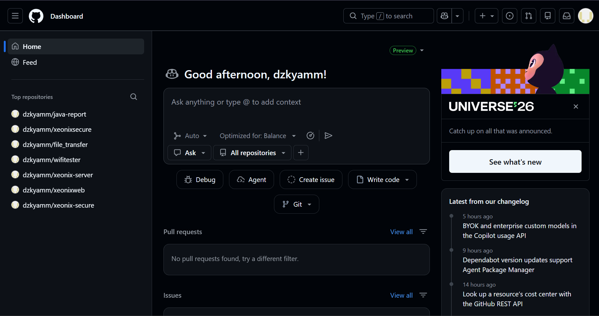
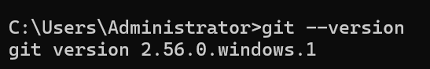
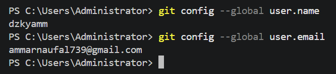
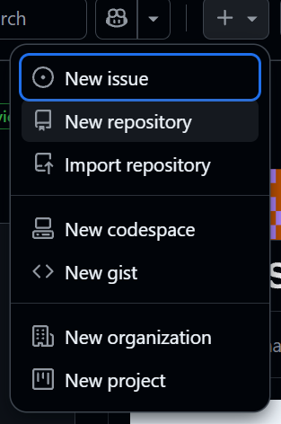

# JOBSHEET 6 - CASE STUDY: SELECTION STRUCTURES WITH GIT AND GITHUB

**Student Identity:**

- **Name:** **[Muhamad Dzaky Ammar Naufal]**
- **Student ID (NIM):** **[264107020222]**
- **Class / Attendance No.:** **[1I/21]**


---

## 1: PRACTICUM OBJECTIVES

The objectives of this practicum are as follows:

- Students can solve case studies using basic and nested selection structures.
- Students can save and submit their work using Git and GitHub through Visual Studio Code.
- Students can collaborate with classmates using GitHub.

---

## 2: EXPERIMENT RESULTS & ANALYSIS

### 2.1 Initial Setup (Git, GitHub, and Git Identity)

Before starting the experiments, a GitHub account was prepared, Git was installed, and the Git identity (name and email) was configured so that it is recorded as the author of every commit.

#### 2.1.1 GitHub Account



#### 2.1.2 Git Installation



#### 2.1.3 Git Identity Configuration



---

### 2.2 Experiment 1: Setting Up a Repository

A public repository named `PraktikumDaspro21` was created on GitHub, cloned to the computer using VS Code, then a `README.md` file was added, committed, and pushed.

#### 2.2.1 Steps Performed

1. Created a new repository `PraktikumDaspro21` on GitHub (visibility **Public**, Add README **Off**).
2. Copied the repository URL (HTTPS) from the **Quick setup** page.
3. In VS Code: **Clone Git Repository...** → pasted the URL → **Clone from URL** → chose the destination folder → **Open**.
4. Created `README.md` containing the identity (Name, Student ID, Class). Status changed to **U (Untracked)**.
5. **Add (Stage):** clicked the **+** icon in Source Control. Status changed to **A (Added)**.
6. **Commit** with the message `Added identity information to README`.
7. **Push** to GitHub (**... → Push** or **Publish Branch**) and signed in via browser on the first push.
8. Refreshed the repository page on GitHub to confirm `README.md` appears.

#### 2.2.2 Content of the Initial README.md

```
Ini adalah repository pertama saya
Nama   : Muhamad Dzaky Ammar Naufal
NIM    : 264107020222
Kelas  : 1I/21
```

#### 2.2.3 Evidence

**a. New repository menu on GitHub (+ → New repository)**



**b. Cloning the repository in VS Code**

> **[FILL IN: Screenshot of VS Code after the clone finishes (Explorer shows the folder `PraktikumDaspro21`).]**


**c. README.md untracked (U) and staged (A)**

> **[FILL IN: Screenshot of the Source Control panel showing `README.md` with status U, and another showing status A after Stage Changes.]**


**d. Commit**

> **[FILL IN: Screenshot of the commit message typed in Source Control before clicking Commit.]**


**e. Push**

> **[FILL IN: Screenshot of the Push / Publish Branch process (or the "Connect to GitHub" login window if it appears).]**


**f. Result on GitHub**

> **[FILL IN: Screenshot of the GitHub repository page showing `README.md` and your first commit.]**


#### 2.2.4 Analysis

Git works in three stages: the file is first **untracked (U)**, then moved to the **staging area (A)** with *Add*, then saved as a new version in the **local repository** with *Commit*. The commit only exists on the computer until it is sent to GitHub with *Push*. This separation lets us choose exactly which changes go into each version and describe them with a clear commit message.

---

### 2.3 Experiment 2: Case Study 1 – Basic Selection

Kedai Kopi Senja sells Kopi Susu Gula Aren for Rp18,000 per cup and gives a 10% discount on purchases of at least Rp100,000. The cashier program calculates the total payment and the change, based on the given flowchart.

#### 2.3.1 Java Program Code

File: [`code/StudiKasus121.java`](code/StudiKasus121.java)

```java
import java.util.Scanner;

public class StudiKasus121 {
    public static void main(String[] args) {
        Scanner input = new Scanner(System.in);

        // Variable declarations based on the flowchart
        int hargaPerCup = 18000;
        int jumlahCup, uangBayar;
        int totalHarga, diskon, totalBayar;
        int kembalian, kurang;

        // Input
        System.out.print("Masukkan jumlah cup  : ");
        jumlahCup = input.nextInt();
        System.out.print("Masukkan uang bayar  : ");
        uangBayar = input.nextInt();

        // Calculate total price, initial discount = 0
        totalHarga = jumlahCup * hargaPerCup;
        diskon = 0;

        // 10% discount if total price >= Rp100,000
        if (totalHarga >= 100000) {
            diskon = totalHarga * 10 / 100;
        }

        totalBayar = totalHarga - diskon;

        System.out.println("Total harga          : Rp " + totalHarga);
        System.out.println("Diskon               : Rp " + diskon);
        System.out.println("Total bayar          : Rp " + totalBayar);

        // Check whether the money is enough
        if (uangBayar >= totalBayar) {
            kembalian = uangBayar - totalBayar;
            System.out.println("Kembalian            : Rp " + kembalian);
        } else {
            kurang = totalBayar - uangBayar;
            System.out.println("Uang tidak cukup, kurang Rp " + kurang);
        }

        input.close();
    }
}
```

#### 2.3.2 Output

Output for the input `3` cups and `50000` money paid:

```
Masukkan jumlah cup  : 3
Masukkan uang bayar  : 50000
Total harga          : Rp 54000
Diskon               : Rp 0
Total bayar          : Rp 54000
Uang tidak cukup, kurang Rp 4000
```

> **[FILL IN: Screenshot of your program running in VS Code with the input above (3 cups, Rp50,000).]**


#### 2.3.3 Test Table

| **No** | **Cups** | **Money Paid** | **Total Price** | **Discount** | **Total to Pay** | **Output** |
| --- | --- | --- | --- | --- | --- | --- |
| 1 | 3 | 50000 | 54000 | 0 | 54000 | Uang tidak cukup, kurang Rp 4000 |
| 2 | 3 | 60000 | 54000 | 0 | 54000 | Kembalian Rp 6000 |
| 3 | 5 | 90000 | 90000 | 0 | 90000 | Kembalian Rp 0 |
| 4 | 6 | 100000 | 108000 | 10800 | 97200 | Kembalian Rp 2800 |
| 5 | 6 | 90000 | 108000 | 10800 | 97200 | Uang tidak cukup, kurang Rp 7200 |

#### 2.3.4 Git Evidence

Commits made for this case study:

| **Commit** | **Message** | **Content** |
| --- | --- | --- |
| 1 | `SK1: input and variable declaration` | Variable declarations, input, and total price calculation |
| 2 | `SK1: discount and change logic` | Discount selection, total to pay, and change / shortage selection |

> **[FILL IN: Screenshot of the commit history on GitHub (Commits page) showing both SK1 commits.]**


> **[FILL IN: Screenshot of the GitHub repository page showing the file `StudiKasus121.java` after Push.]**


#### 2.3.5 Analysis

The program uses two separate basic `if` structures that follow the flowchart. The first `if` (`totalHarga >= 100000`) has no `else` because the discount is already initialised to `0`; it only changes when the condition is true. The second `if-else` (`uangBayar >= totalBayar`) has two exclusive paths: calculating the change, or calculating the shortage. Both paths merge again at the end of the program, just like the "Selesai" point in the flowchart. The discount uses integer calculation (`totalHarga * 10 / 100`), which is safe here because every price is a multiple of Rp1,000.

---

### 2.4 Experiment 3: Case Study 2 – Nested Selection

The program checks the award-fund status of a student according to the Student Affairs letter (Activity Year 2026, Stage I). Only the data needed for each activity type is asked: competitions (BELMAWA, BAKORMA, Mandiri) need the document count and rank, PKM needs the document count and funding status, and Other (Lainnya) needs nothing more. The maximum nesting depth is 3 levels.

#### 2.4.1 Selection Rules

| **Activity Type** | **Requirement for Award Funds** | **Documents** |
| --- | --- | --- |
| BELMAWA / BAKORMA / Mandiri | Rank 1st, 2nd, or 3rd | Must be 4 |
| PKM | Proposal approved for funding (1) | Must be 4 |
| Lainnya (Other) | Not eligible | Not asked |

#### 2.4.2 Java Program Code

File: [`code/StudiKasus221.java`](code/StudiKasus221.java)

```java
import java.util.Scanner;

public class StudiKasus221 {
    public static void main(String[] args) {
        Scanner input = new Scanner(System.in);

        System.out.print("Nama mahasiswa  : ");
        String nama = input.nextLine();
        System.out.print("Jenis kegiatan (BELMAWA/BAKORMA/MANDIRI/PKM/LAINNYA) : ");
        String jenis = input.nextLine().trim();

        String status;

        // Level 1: activity type
        if (jenis.equalsIgnoreCase("BELMAWA") || jenis.equalsIgnoreCase("BAKORMA")
                || jenis.equalsIgnoreCase("MANDIRI")) {
            // Competition: ask for documents and rank
            System.out.print("Jumlah dokumen  : ");
            int dokumen = input.nextInt();
            System.out.print("Peringkat juara : ");
            int peringkat = input.nextInt();

            // Level 2: rank must be 1, 2, or 3
            if (peringkat >= 1 && peringkat <= 3) {
                // Level 3: document completeness
                if (dokumen == 4) {
                    status = "Berhak menerima dana penghargaan (juara " + peringkat + ").";
                } else {
                    status = "Dokumen tidak lengkap (kurang " + (4 - dokumen)
                            + " dokumen). Dana penghargaan tidak diberikan.";
                }
            } else {
                status = "Tidak berhak menerima dana penghargaan (hanya untuk juara 1/2/3).";
            }

        } else if (jenis.equalsIgnoreCase("PKM")) {
            // PKM: ask for documents and funding status
            System.out.print("Jumlah dokumen  : ");
            int dokumen = input.nextInt();
            System.out.print("Status pendanaan PKM (1 = disetujui, 0 = tidak) : ");
            int pendanaan = input.nextInt();

            // Level 2: proposal approved?
            if (pendanaan == 1) {
                // Level 3: document completeness
                if (dokumen == 4) {
                    status = "Berhak menerima dana penghargaan (proposal PKM disetujui didanai).";
                } else {
                    status = "Dokumen tidak lengkap (kurang " + (4 - dokumen)
                            + " dokumen). Dana penghargaan tidak diberikan.";
                }
            } else {
                status = "Tidak berhak menerima dana penghargaan (proposal PKM tidak disetujui).";
            }

        } else if (jenis.equalsIgnoreCase("LAINNYA")) {
            status = "Tidak berhak menerima dana penghargaan (jenis kegiatan tidak termasuk ketentuan).";
        } else {
            status = "Jenis kegiatan tidak dikenali.";
        }

        System.out.println("Status : " + status);
        input.close();
    }
}
```

#### 2.4.3 Output

Output for the input `Dori`, `bakorma`, `3`, `1`:

```
Nama mahasiswa  : Dori
Jenis kegiatan (BELMAWA/BAKORMA/MANDIRI/PKM/LAINNYA) : bakorma
Jumlah dokumen  : 3
Peringkat juara : 1
Status : Dokumen tidak lengkap (kurang 1 dokumen). Dana penghargaan tidak diberikan.
```

> **[FILL IN: Screenshot of your program running in VS Code with the input above (Dori, bakorma, 3 documents, rank 1).]**


#### 2.4.4 Test Table

| **No** | **Type** | **Documents** | **Rank / Funding** | **Output** | **Correct?** |
| --- | --- | --- | --- | --- | --- |
| 1 | BAKORMA | 3 | Rank 1 | Dokumen tidak lengkap (kurang 1 dokumen). Dana penghargaan tidak diberikan. | Yes |
| 2 | Mandiri | 4 | Rank 0 | Tidak berhak menerima dana penghargaan (hanya untuk juara 1/2/3). | Yes |
| 3 | pkm | 4 | Funding 1 | Berhak menerima dana penghargaan (proposal PKM disetujui didanai). | Yes |
| 4 | Lainnya | (not asked) | (not asked) | Tidak berhak menerima dana penghargaan (jenis kegiatan tidak termasuk ketentuan). | Yes |
| 5 | BELMAWA | 4 | Rank 2 | Berhak menerima dana penghargaan (juara 2). | Yes |
| 6 | PKM | 4 | Funding 0 | Tidak berhak menerima dana penghargaan (proposal PKM tidak disetujui). | Yes |
| 7 | PKM | 2 | Funding 1 | Dokumen tidak lengkap (kurang 2 dokumen). Dana penghargaan tidak diberikan. | Yes |

#### 2.4.5 Git Evidence

Commits made for this case study:

| **Commit** | **Message** | **Content** |
| --- | --- | --- |
| 1 | `SK2: competition branch` | Input and the competition branch (BELMAWA / BAKORMA / Mandiri) |
| 2 | `SK2: PKM and other branches` | PKM branch, Other branch, and final output |

> **[FILL IN: Screenshot of the commit history on GitHub showing both SK2 commits.]**


> **[FILL IN: Screenshot of the GitHub repository page showing the file `StudiKasus221.java` after Push.]**


#### 2.4.6 Analysis

The nesting has exactly three levels. **Level 1** checks the activity type (the `else if` chain does not add depth). **Level 2** checks the main requirement: rank 1–3 for competitions, or funding status for PKM. **Level 3** checks document completeness, so the documents are only checked for students who already meet condition a or b, as stated in the letter. A student who is not a winner is rejected at level 2 without looking at the documents. The program asks for data only when it is needed: the `Lainnya` branch asks nothing more, and PKM never asks for a rank. `equalsIgnoreCase` makes the activity type not case-sensitive, and `4 - dokumen` gives the number of missing documents.

---

### 2.5 Experiment 4: Cross-Testing a Classmate's Program

In this experiment the work is done in pairs: the repository owner invites the classmate as a collaborator, and the invited student clones the repository, tests `StudiKasus221.java`, and writes the test results into `README.md`.

#### 2.5.1 Pair Information

- **Classmate's name:** **[FILL IN: classmate's name]**
- **Classmate's GitHub username:** **[FILL IN: username]**
- **Classmate's repository:** **[FILL IN: repository name, e.g. PraktikumDaspro__]**

#### 2.5.2 Role 1: As Repository Owner (my repository is tested)

**a. Adding the classmate as a collaborator** (Settings → Collaborators → Add people)

> **[FILL IN: Screenshot of the Collaborators page after adding your classmate's username.]**


**b. Pulling the classmate's changes** (... → Pull or Sync Changes)

> **[FILL IN: Screenshot of VS Code after the Pull, showing the classmate's test results inside `README.md`.]**


**c. Commit history on GitHub**

> **[FILL IN: Screenshot of the Commits page on GitHub showing your classmate's commit "Test results for SK2 by <Name>".]**


#### 2.5.3 Role 2: As Invited Student (I test my classmate's program)

**a. Accepting the invitation**

> **[FILL IN: Screenshot of the invitation email / page after clicking "Accept invitation".]**


**b. Cloning the classmate's repository**

> **[FILL IN: Screenshot of VS Code after cloning your classmate's repository.]**


**c. Running the classmate's program with 3 test cases**

> **[FILL IN: Screenshot of the classmate's program running for test case 1.]**


> **[FILL IN: Screenshot of the classmate's program running for test case 2.]**


> **[FILL IN: Screenshot of the classmate's program running for test case 3.]**


**d. Test results (written at the bottom of the classmate's `README.md`)**

Fill in the table below with your classmate's real program output (use the format given in the jobsheet):

```
Test Results for Case Study 2 by <Name>
```

| No | Type | Documents | Rank/Funding | Output | Correct? |
|----|------|-----------|--------------|--------|----------|
| 1 | BAKORMA | 3 | 1 | **[FILL IN]** | **[Yes/No]** |
| 2 | Mandiri | 4 | 0 | **[FILL IN]** | **[Yes/No]** |
| 3 | pkm | 4 | 1 | **[FILL IN]** | **[Yes/No]** |
| 4 | Lainnya | 4 | (not asked) | **[FILL IN]** | **[Yes/No]** |

> **[FILL IN: Screenshot of the classmate's `README.md` in VS Code with the test results added, and the Commit & Push with the message "Test results for SK2 by <Name>".]**


#### 2.5.4 Reference: Expected Results of My Own Program

These are the results of my own `StudiKasus221.java` for the jobsheet's test data, as a reference for the classmate who tests it:

| Type of Activity | Documents | Rank / Funding | Expected Output | My Program's Output |
| --- | --- | --- | --- | --- |
| BAKORMA | 3 | 1st Place | Documents incomplete (1 document missing). No award funds given. | Dokumen tidak lengkap (kurang 1 dokumen). Dana penghargaan tidak diberikan. |
| Mandiri | 4 | 0 | Not eligible (only for 1st/2nd/3rd place). | Tidak berhak menerima dana penghargaan (hanya untuk juara 1/2/3). |
| pkm | 4 | 1 (approved) | Eligible (PKM proposal approved for funding). | Berhak menerima dana penghargaan (proposal PKM disetujui didanai). |
| Lainnya | 4 | (not asked) | Not eligible (activity type not covered). | Tidak berhak menerima dana penghargaan (jenis kegiatan tidak termasuk ketentuan). |

#### 2.5.5 Analysis

> **[FILL IN: Your own short notes — whether any of your classmate's results were wrong, whether your program had any bug found by your classmate, and what you fixed. If nothing was wrong, write that all test cases matched the expected output.]**

---

## 3: CONCLUSION

Basic selection (`if` and `if-else`) is enough for simple decisions such as the discount and change calculation in Case Study 1, while nested selection is needed when conditions must be checked in stages, as in Case Study 2, where the rank or funding status is checked first and the documents only afterwards. Keeping the nesting to three levels and using `else if` chains for the activity type keeps the code readable. Git and GitHub through VS Code make it possible to save work as separate versions (Add → Commit), send it to a remote repository (Push), and get a classmate's changes (Pull). Because every commit has a message, the work history is easy to follow, and collaborators can test and improve each other's programs. One important habit is to always Pull before working on a shared repository, to avoid conflicts when two people change the same file.
